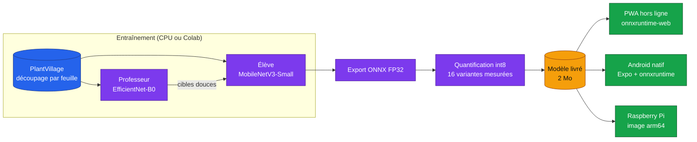

# Edge Plant Doctor

<!-- adam-badges:start -->
[](CHANGELOG.md)
[](https://github.com/Adam-Blf/edge-plant-doctor/actions/workflows/ci.yml)
[](https://github.com/Adam-Blf/edge-plant-doctor/actions/workflows/android-apk.yml)
[](https://adam-blf.github.io/edge-plant-doctor/)
[](https://github.com/Adam-Blf/edge-plant-doctor/commits)
[](LICENSE)
[](https://colab.research.google.com/github/Adam-Blf/edge-plant-doctor/blob/main/notebooks/train_colab.ipynb)
<!-- adam-badges:end -->

Reconnaître la maladie d'une feuille sur le téléphone ou sur une Raspberry Pi, sans réseau. Un MobileNetV3-Small affiné sur PlantVillage (38 classes), distillé depuis un EfficientNet-B0 puis quantifié en int8, tourne dans une PWA, une application Android native et un service arm64.

Projet du cours MLOps du Mastère Data Engineering et IA de l'EFREI, sujet « Embarquer un modèle », réalisé en binôme.

## Résultats

| | Élève seul FP32 | Élève distillé FP32 | **Modèle livré (int8)** |
|---|---:|---:|---:|
| Précision sur le test (3 579 images) | 97,93 % | 98,32 % | **98,24 %** |
| Taille | 6,24 Mo | 6,24 Mo | **2,00 Mo** |
| Latence p50, x86, 1 thread | 8,8 ms | 8,2 ms | **7,6 ms** |
| Accélération sous arm64 émulé | 1,00x | 1,00x | **1,75x** |

Le modèle livré est l'élève distillé, quantifié en int8 statique avec une calibration percentile. La convolution d'entrée et les convolutions en profondeur restent en flottant : passées seules en int8, elles font tomber la précision à 25 % et 40 %. Analyse complète, 16 variantes et limites dans [`docs/results.md`](docs/results.md), méthode dans [`docs/method.md`](docs/method.md).

## Couverture du sujet

| Niveau | Exigence | Où |
|---|---|---|
| 1 | Un modèle non trivial empaqueté | `src/edgeplant/`, export ONNX |
| 2 | Une ou plusieurs quantifications | dynamique et statique (min-max, percentile, entropie), `quantize.py` |
| 2 | Comparaison quantifié et non quantifié | précision, taille, latence x86 et arm64, `docs/results.md` |
| 2 | Déploiement du meilleur modèle sur la cible | PWA, APK Android, image Raspberry Pi |
| Bonus | Distillation | professeur EfficientNet-B0, `distill.py` |

## Architecture



Le prétraitement (recadrage carré, réduction par moyenne de surface, normalisation ImageNet) est écrit une fois en Python et une fois en TypeScript. Un test compare les deux sorties à 1e-4 près.

## Les trois cibles

| Cible | Comment l'utiliser | Détail |
|---|---|---|
| PWA | ouvrir https://adam-blf.github.io/edge-plant-doctor/ puis « Ajouter à l'écran d'accueil » | `app/`, fonctionne hors ligne après la première visite |
| Android | télécharger `plant-doctor.apk` dans la [dernière release](https://github.com/Adam-Blf/edge-plant-doctor/releases/latest) | [`android-app/README.md`](android-app/README.md), permission Internet bloquée |
| Raspberry Pi | `docker run` de l'image arm64 ou service Python | [`edge/rpi/README.md`](edge/rpi/README.md) |

L'APK est signée avec la clé de débogage : installable pour une démonstration, pas publiable sur le Play Store. L'application Android et le paquet Raspberry Pi n'ont pas été mesurés sur un vrai appareil. Les latences arm64 viennent d'une émulation QEMU et ne valent que pour comparer les modèles entre eux.

## Reproduire

```bash
pip install -e ".[dev]"
python -m edgeplant.data                  # cache des images et découpage par feuille
python -m edgeplant.teacher               # professeur
python -m edgeplant.train                 # élève seul
python -m edgeplant.distill --epochs 4    # élève distillé
python -m edgeplant.export --arch student --tag student_distilled
python -m edgeplant.quantize --tag student_distilled
python -m edgeplant.evaluate checkpoints/student_*.onnx
python -m edgeplant.latency checkpoints/student_*.onnx --threads 1 4 --out results/latency_x86.json
python -m edgeplant.ablation              # une famille de couches à la fois
python -m edgeplant.report_assets         # tables et figures de docs/
```

Sans GPU, le notebook Colab (badge en tête) rejoue la même chaîne sur un T4.

## Qualité

```bash
pytest                                       # Python : données, distillation, export, quantification, service RPi, parité web
ruff check . && ruff format --check .
cd app && npm ci && npm test && npm run build
cd android-app && npm ci && npx tsc --noEmit && npx jest
```

La CI rejoue ces contrôles à chaque PR, construit l'image arm64 et l'APK, et déploie la PWA sur GitHub Pages depuis `main`.

## Licence

MIT, voir [LICENSE](LICENSE). Jeu de données PlantVillage (Hughes et Salathé, 2015).
