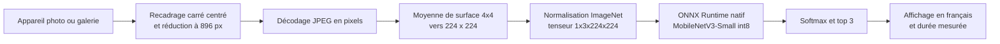

# Plant Doctor pour Android

Application Android native (React Native, Expo, TypeScript) du projet EFREI M2 Edge Plant Doctor : le diagnostic d'une maladie de plante à partir d'une photo de feuille, entièrement sur le téléphone, sans réseau. C'est le pendant natif de la PWA du même projet, avec le même modèle, les mêmes couleurs, la même police et les mêmes icônes.

## Comment ça marche



- **Modèle** : `assets/model/plant-doctor-int8.onnx` (2 Mo), un MobileNetV3-Small distillé puis quantifié en int8, 38 classes PlantVillage. Les libellés français sont dans `assets/model/labels.json`. Les deux fichiers sont copiés tels quels du dépôt de la PWA.
- **Inférence** : `onnxruntime-react-native`, le moteur natif (pas de WebAssembly), configuré par son plugin Expo `onnxruntime-react-native` dans `app.json`. Le modèle est un asset Metro, `expo-asset` en donne un chemin local à ONNX Runtime. Fournisseur d'exécution : CPU.
- **Prétraitement** (`src/preprocess.ts`) : port à l'identique de `app/src/preprocess.ts` de la PWA, lui-même miroir de `src/edgeplant/preprocess.py`. Recadrage carré centré, réduction par moyenne de surface (chaque pixel de sortie est la moyenne exacte de la zone source qu'il couvre), normalisation ImageNet, tenseur NCHW.
- **Résultat** : les trois classes les plus probables avec culture et état en français, probabilité (softmax), vert pour une feuille saine et rouille pour une feuille malade, avertissement sous 60 % de confiance, et durée de l'inférence mesurée sur l'appareil.
- **Design** : jetons de couleur de la PWA en clair et en sombre (suit le réglage d'Android), police Be Vietnam Pro embarquée localement (aucun CDN), icônes Reicon uniquement (`src/icons/paths.ts`, tracés Outline repris du paquet `reicon` utilisé par la PWA, affichés par `react-native-svg`). Les contrastes de texte sont testés (4,5:1 minimum).

### Écart de prétraitement avec Python

React Native n'a pas de canvas. La chaîne est donc : `expo-image-manipulator` recadre le carré central et le réduit à **896 x 896** (exactement 4 fois 224), `jpeg-js` décode ces pixels, puis `src/preprocess.ts` fait la moyenne de surface 4x4 exacte vers 224 x 224.

C'est la seule différence avec la référence Python, qui réduit l'original en une seule moyenne de surface. Ici, la réduction se fait en deux temps : un premier redimensionnement par le moteur d'image d'Android (algorithme du système, pas notre moyenne de surface), puis la moyenne exacte 4x4. Le résultat n'est donc pas identique au pixel près à celui de Python. La PWA fait déjà le même détour (elle dessine d'abord à 896 px au plus). Deux autres détails : la photo passe par un JPEG de qualité maximale entre le recadrage et le décodage, et la parité numérique n'est prouvée que pour la partie TypeScript (voir les tests).

## Construire l'APK

L'APK est construit uniquement par GitHub Actions (`.github/workflows/android-apk.yml`), car il n'y a pas de SDK Android sur le poste de développement. Le workflow tourne à chaque push qui touche `android-app/**`, à chaque tag `vX.Y.Z` et à la demande (`workflow_dispatch`) :

1. `npm ci`, vérification des types (`tsc`) et tests (`jest`).
2. `npx expo prebuild -p android` génère le projet natif (il n'est jamais commité, `android/` est ignoré).
3. `./gradlew assembleRelease` construit l'APK, pour arm64-v8a (téléphones) et x86_64 (émulateur).
4. L'APK est publié en artefact `plant-doctor-apk`. Sur un tag, il est aussi joint à la release GitHub (créée si elle n'existe pas) sous le nom `plant-doctor-vX.Y.Z.apk`. Le tag doit être égal à la `version` de `android-app/package.json`, sinon le workflow s'arrête.

Pour une release : monter la version dans `android-app/package.json` et `app.json`, puis `git tag vX.Y.Z && git push --tags`.

En local, tout ce qui ne demande pas le SDK Android fonctionne :

```bash
cd android-app
npm ci
npm run typecheck
npm test
npx expo prebuild -p android --no-install   # contrôle de la configuration seulement
```

## Installer l'APK

1. Télécharger `plant-doctor.apk` depuis l'artefact `plant-doctor-apk` de l'exécution du workflow (onglet Actions, il faut être connecté à GitHub), ou depuis la page Releases du dépôt pour un tag.
2. Copier le fichier sur le téléphone et l'ouvrir. Android demande d'autoriser l'installation depuis cette source (réglage « Installer des applications inconnues »), puis installe.
3. Au premier diagnostic par appareil photo, accepter l'accès à la caméra. La galerie n'a besoin d'aucune autorisation.

Pour un émulateur : `adb install plant-doctor.apk`.

## Limites

- **Prétraitement** : réduction en deux temps via 896 px, voir plus haut. Les tests prouvent que la partie TypeScript reproduit les valeurs de la PWA, pas que l'ensemble de la chaîne Android donne les mêmes probabilités que Python sur une vraie photo.
- **Signature de debug** : la variante release est signée avec la clé de debug du modèle Expo, ce qui suffit pour une démonstration scolaire. L'APK n'est pas publiable sur le Play Store, et deux builds de la CI n'ont pas forcément la même clé, donc une mise à jour par-dessus une installation précédente peut être refusée (il faut alors désinstaller d'abord).
- **Latence mesurée sur l'appareil uniquement** : la durée affichée est celle de `session.run` plus softmax et top 3, mesurée avec `performance.now()` sur le téléphone, et le prétraitement est affiché à part. Aucun chiffre de latence n'a été mesuré en développement, puisqu'il n'y a pas d'appareil ni d'émulateur sur le poste. Elle varie selon le téléphone, sa température et la charge.
- **Domaine du modèle** : entraîné sur PlantVillage (photos de laboratoire, une feuille sur fond uni). Sur le terrain, la réponse peut se tromper.
- **Android seulement** : le plugin ONNX Runtime et la configuration visent Android. Expo Go ne convient pas, il faut un build de développement ou ce build de release.

## Structure

```
android-app/
  app.json                 configuration Expo et plugins
  metro.config.js          extension .onnx traitée comme un asset
  assets/model/            modèle int8 et libellés français
  assets/fonts/            Be Vietnam Pro 500, 700, 800 (TTF, voir ci-dessous)
  src/preprocess.ts        recadrage, moyenne de surface, normalisation
  src/image.ts             photo vers tenseur (manipulator, jpeg-js)
  src/inference.ts         session ONNX Runtime native
  src/scores.ts            softmax et top k
  src/icons/               tracés Reicon et composant react-native-svg
  tests/                   jest (parité PWA, softmax, contraste)
```

Les polices sont les mêmes fichiers que ceux de la PWA (`@fontsource/be-vietnam-pro`, licence SIL OFL 1.1), reconvertis de WOFF en TTF sans changement de glyphes : Android ne sait pas lire le WOFF ni le WOFF2.
