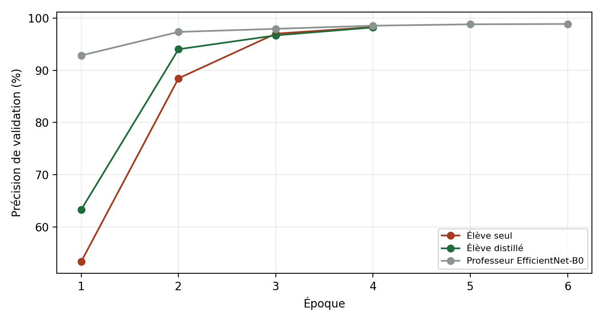
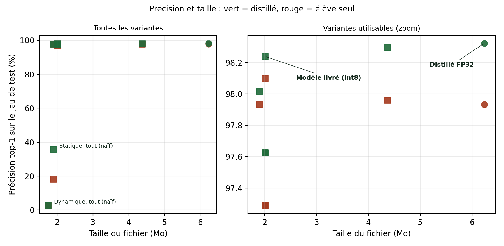
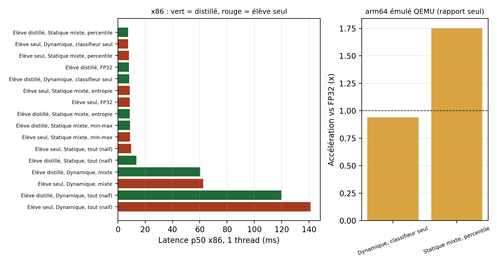

# Résultats

Toutes les valeurs de cette page viennent des fichiers de `results/`, régénérés par `python -m edgeplant.report_assets`. Les tableaux complets (16 variantes, latences x86 à 1 et 4 threads, arm64 émulé, étude par famille de couches) sont dans [`results_tables.md`](results_tables.md). La méthode est décrite dans [`method.md`](method.md).

## Le modèle retenu

L'élève distillé, quantifié en int8 statique avec une calibration percentile, la convolution d'entrée et les convolutions en profondeur restant en flottant.

| | Élève seul FP32 | Élève distillé FP32 | **Modèle livré** |
|---|---:|---:|---:|
| Précision (test, 3 579 images) | 97,93 % | 98,32 % | **98,24 %** |
| F1 macro | 97,91 % | 98,33 % | **98,22 %** |
| Taille | 6,24 Mo | 6,24 Mo | **2,00 Mo** |
| Latence p50, x86, 1 thread | 8,8 ms | 8,2 ms | **7,6 ms** |
| Latence p50, arm64 émulé | 4 573 ms | 3 981 ms | **2 270 ms** |

Le fichier est trois fois plus léger que le modèle flottant, pour 0,08 point de précision perdu par rapport au distillé FP32. C'est lui qu'embarquent la PWA, le paquet Raspberry Pi et l'application Android.

## Ce que la distillation apporte

Le professeur EfficientNet-B0 atteint 98,87 % en validation. En validation, l'élève distillé (98,21 %) ne fait pas mieux que l'élève seul (98,28 %). Sur le jeu de test, plus grand et jamais vu pendant les choix, il gagne 0,39 point (98,32 % contre 97,93 %), et l'écart se retrouve après quantification (98,24 % contre 98,10 % pour la même recette). Le gain est réel mais petit. Nous le présentons comme tel : sur un jeu aussi propre que PlantVillage, l'élève seul est déjà proche du plafond.

Les durées d'entraînement (82 min pour l'élève seul, 32 min pour le distillé, 71 min pour le professeur) ont été mesurées sur un poste partagé, avec d'autres calculs en parallèle. Elles ne permettent pas de comparer les méthodes entre elles.

## Pourquoi la quantification naïve échoue

Tout passer en int8 effondre le réseau : 2,9 % en dynamique et 35,9 % en statique pour l'élève distillé, autrement dit le hasard sur 38 classes ou guère mieux. Nous avons quantifié une famille de couches à la fois, le reste en flottant, sur les 1 508 images de validation :

| Famille passée seule en int8 | Couches | Précision |
|---|---:|---:|
| Convolution d'entrée | 1 | 25,33 % |
| Convolutions en profondeur | 11 | 39,79 % |
| Convolutions ponctuelles | 40 | 98,01 % |
| Classifieur | 2 | 98,21 % |

Deux familles suffisent à détruire le modèle, et ce sont les plus petites. La convolution d'entrée reçoit l'image normalisée, dont la dynamique n'a rien à voir avec celle des couches suivantes. Les convolutions en profondeur n'ont qu'un canal d'entrée par filtre, si bien qu'aucune moyenne ne vient compenser l'erreur d'arrondi. Elles restent donc en flottant, et les 40 convolutions ponctuelles, qui portent l'essentiel des poids, passent en int8. C'est ce qui ramène le fichier à 2 Mo.

## Calibration et vitesse

- La calibration percentile donne 98,24 %. Min-max et entropie donnent 97,63 % : sur MobileNetV3, quelques activations extrêmes étirent l'échelle quand on garde le minimum et le maximum bruts.
- La quantification dynamique avec îlots flottants garde la précision (98,02 %) mais coûte 60 ms par image contre 8 ms. Elle quantifie les activations à la volée, entre chaque couche qui reste en flottant, et cette conversion coûte plus cher que le calcul gagné.
- Quantifier seulement le classifieur (dynamique, 4,37 Mo) ne gagne presque rien en taille : le classifieur pèse peu dans MobileNetV3-Small. Sous arm64 émulé, cette variante est même un peu plus lente que le FP32 (0,94 fois sa vitesse).

Sous émulation arm64 (QEMU), le modèle livré est 1,75 fois plus rapide que le distillé FP32. Les valeurs absolues ne valent rien, l'émulation ralentit tout d'un facteur mille environ. Seul le rapport entre modèles a un sens, et il va dans le même sens que sur x86. Aucune vraie Raspberry Pi n'a été mesurée.

## Limites

- Une seule graine d'entraînement : les écarts de quelques dixièmes de point entre variantes sont dans le bruit d'un second tirage.
- Les classes sont plafonnées (150 images d'entraînement par classe) pour tenir sur un processeur. Le professeur et l'élève pourraient faire mieux avec le jeu complet.
- Les latences x86 viennent d'un poste partagé. Les modèles ont été mesurés entrelacés, ce qui protège leurs rapports, pas leurs valeurs.
- PlantVillage photographie des feuilles isolées sur fond uni. Une photo prise au champ, avec plusieurs feuilles et un fond chargé, sortirait de cette distribution.
